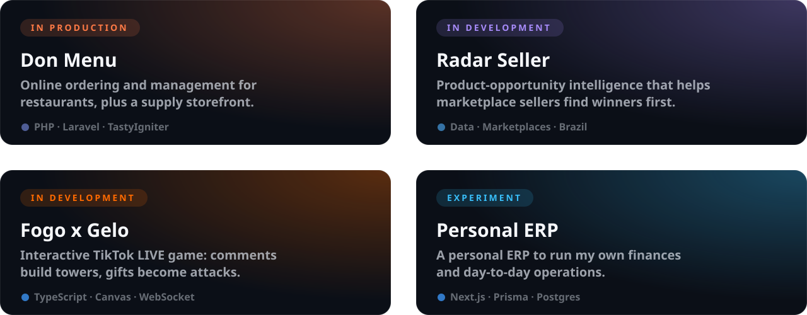
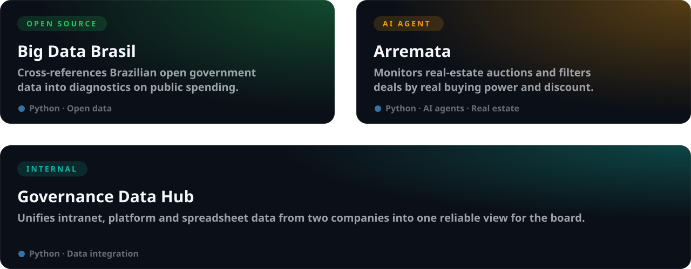
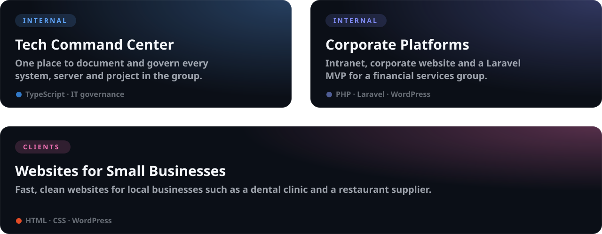

<picture>
  <source media="(prefers-color-scheme: dark)" srcset="assets/hero-dark.svg">
  <source media="(prefers-color-scheme: light)" srcset="assets/hero-light.svg">
  
</picture>

  
  
  

## About

IT Director at a financial services group and fullstack developer with **10+ years** turning messy processes into simple software. I lead technology end to end, from governance and infrastructure to the products themselves, and I still ship code every week.

- **Products** of my own, from restaurant SaaS to marketplace intelligence and live games.
- **Data and AI**: open government data, decision dashboards and agents that do the tedious work.
- **IT leadership**: documenting, governing and modernizing the systems a business runs on.

## Projects

### Products

<picture>
  <source media="(prefers-color-scheme: dark)" srcset="assets/projects-products-dark.svg">
  <source media="(prefers-color-scheme: light)" srcset="assets/projects-products-light.svg">
  
</picture>

### Data & AI

<picture>
  <source media="(prefers-color-scheme: dark)" srcset="assets/projects-data-dark.svg">
  <source media="(prefers-color-scheme: light)" srcset="assets/projects-data-light.svg">
  
</picture>

Big Data Brasil is open source: <a href="https://github.com/wpatriota/BigDataBrasil">wpatriota/BigDataBrasil</a>

### IT leadership

<picture>
  <source media="(prefers-color-scheme: dark)" srcset="assets/projects-it-dark.svg">
  <source media="(prefers-color-scheme: light)" srcset="assets/projects-it-light.svg">
  
</picture>

### Earlier open source

| Project | What it is | Stack |
|---|---|---|
| [public-donation-symfony-react](https://github.com/wpatriota/public-donation-symfony-react) | Donation management with an API-first backend | Symfony · API Platform · React |
| [public-systemdonation](https://github.com/wpatriota/public-systemdonation) | Donation control system | PHP · TypeScript · Docker |
| [public-vendas](https://github.com/wpatriota/public-vendas) | Customers, products and sales management | PHP · TypeScript · Docker |
| [movie-app](https://github.com/wpatriota/movie-app) | Movie catalog built as a hiring challenge | Laravel · React |
| [school-app](https://github.com/wpatriota/school-app) | School management | Laravel |
| [nutri-app](https://github.com/wpatriota/nutri-app) | Nutrition app | React |
| [nodejs-crud-bookmark](https://github.com/wpatriota/nodejs-crud-bookmark) | Bookmark manager CRUD | Node.js |
| [findfix](https://github.com/wpatriota/findfix) | Small management system | Symfony |
| [invests-app](https://github.com/wpatriota/invests-app) | Parses investment statements from text files | PHP |
| [wpatriota.github.io](https://github.com/wpatriota/wpatriota.github.io) | Personal portfolio | React |

## Stack

<picture>
  <source media="(prefers-color-scheme: dark)" srcset="https://skillicons.dev/icons?i=ts%2Cjs%2Creact%2Cnextjs%2Cangular%2Cnodejs%2Cvite%2Cpython%2Cphp%2Claravel%2Csymfony%2Cwordpress%2Cmysql%2Cpostgres%2Cdocker%2Clinux&perline=8&theme=dark">
  <source media="(prefers-color-scheme: light)" srcset="https://skillicons.dev/icons?i=ts%2Cjs%2Creact%2Cnextjs%2Cangular%2Cnodejs%2Cvite%2Cpython%2Cphp%2Claravel%2Csymfony%2Cwordpress%2Cmysql%2Cpostgres%2Cdocker%2Clinux&perline=8&theme=light">
  
</picture>

## Activity

<picture>
  <source media="(prefers-color-scheme: dark)" srcset="https://raw.githubusercontent.com/wpatriota/wpatriota/output/github-snake-dark.svg">
  <source media="(prefers-color-scheme: light)" srcset="https://raw.githubusercontent.com/wpatriota/wpatriota/output/github-snake.svg">
  
</picture>

Most of my work lives in private repositories for products and companies. Happy to talk about it.

